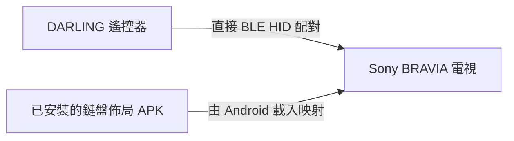

# Sony BRAVIA × DARLING Remote

Use a DARLING BLE remote directly with a Sony BRAVIA TV. An Android keyboard-layout APK fixes OK, Back and Menu, without root, an ESP32 bridge or a background remapping service.

讓 DARLING 藍牙遙控器直接控制 Sony BRAVIA 電視，透過一個鍵盤佈局 APK，補上原本無效的 **OK、返回、三橫線選單**。

## 最後採用的方案



**日常使用不需要 ESP32、Mac、ADB 連線、無障礙服務或常駐按鍵轉換程式。** ADB 只用於初次安裝及選用佈局。前期曾用 ESP32-S3 掃描和嘗試連線，但它沒有參與最後的控制路徑。

## 已測試環境

| 項目 | 實機結果 |
|---|---|
| 電視 | Sony XR-65X90J，中國版 VH2 平台 |
| 系統 | Android 12 / API 31；韌體 682241 |
| 遙控器 | 金色 DARLING，鋰電池、Micro-USB 充電、激光筆；具體產品型號未知 |
| 藍牙名稱 | Mac 顯示 `tKeybd`；電視顯示 `tKEY` |
| HID 識別 | VID `0x248A` / PID `0x8266` |

僅在這組硬件與韌體上驗證，不代表所有 DARLING 或 Sony 型號通用。VID/PID 是固件回報值，**不能據此確認實際芯片型號**。

## 修正原因

電視把這組 VID/PID 對應到 Google 參考遙控器配置：

```text
/system/usr/idc/Vendor_248a_Product_8266.idc
keyboard.layout = Vendor_0957_Product_0001
```

該配置缺少 DARLING 的數字鍵盤 Enter、Esc 和 Application/Menu 鍵。方向、首頁、音量正常，OK、返回和三橫線沒有相應操作。

本專案提供 `type OVERLAY` 的 KCM，補上三行映射：

```text
map key 96 DPAD_CENTER
map key 1 BACK
map key 127 MENU
```

APK 只提供佈局資源，Android 輸入系統直接處理；沒有 Activity、後台 Service、網路權限或按鍵監聽服務。

## 按鍵實測

| 實體按鍵 | HID Usage Page / Usage | 電視行為 |
|---|---|---|
| 上／下／左／右 | `07 / 52, 51, 50, 4F` | 原本即可使用 |
| OK | `07 / 58`，Keypad Enter | 補成確認 `DPAD_CENTER` |
| 返回 | `07 / 29`，Esc | 補成 `BACK` |
| 首頁 | `0C / 0223`，AC Home | 原本即可使用 |
| 右側＋／− | `0C / E9, EA` | 音量增加／減少 |
| 左側準星上／下 | `07 / 41, 42`，F8／F9 | 已辨認；未新增功能 |
| 電源旁三橫線 | `07 / 65`，Linux KEY_COMPOSE | 補成應用內 `MENU` |
| 底部激光筆 | 測試期間未觀察到對應藍牙事件 | 目前無法在電視端映射 |
| 電源 | 原始 HID 鍵碼未另外記錄 | 使用者已實測可直接使用，無需映射 |

**三橫線目前打開的是應用內選單**，例如播放器的選集、清晰度、字幕。它不是 Sony 的畫面／聲音「Quick Settings」快捷列；後者尚未實作。

## 安裝

1. 先讓 DARLING 直接與電視配對。若已連 Mac 或其他主機，先斷開；測試用 ESP32 也應停止連線嘗試。
2. 在電視啟用並授權 ADB，從電腦確認 `adb devices` 能看到它。
3. 從 [Releases](../../releases) 下載 `darling-tv-layout.apk` 和 `layout-control.jar`，放到同一個目錄；或依下節自行建置。
4. 保持遙控器已連線，執行：

```sh
# SERIAL 是 adb devices 列出的裝置識別，例如電視 IP:5555。
sh tools/install-layout.sh SERIAL /path/to/downloaded-files
```

若自行建置，第二個參數可省略，預設使用 `android-layout/build`。

腳本會先讀取目前佈局、安裝 APK，再用一次性的 shell helper 選用新佈局。它會輸出 `BEFORE` 和 `AFTER`，便於保存原設定。**若 BEFORE 不是 null，先記下原佈局 ID。**

安裝後斷開電腦的 ADB，測試 OK、返回與三橫線選單。不要只在 ADB 轉換程式仍運行時測試，否則會混淆結果。

### 保留狀態

- 已實測：停止 Mac 的按鍵轉換程式後，OK、返回仍正常。
- 已實測：三橫線可打開播放器選單。
- 使用者已實測：電源鍵可直接使用，不需新增映射。
- 已觀察：藍牙斷開重連後，已選用的佈局仍在。
- 系統會儲存佈局選擇，預期重啟後保留；**本次尚未完成整機重啟驗證**。
- 不要卸載佈局 APK，否則系統會失去這份資源。

## 自行建置

需要 JDK（支援 `javac --release 8`）、Android SDK Platform 34、Build Tools 35.0.1，以及 `zip`。

```sh
export JAVA_HOME=/path/to/jdk
export ANDROID_SDK_ROOT=/path/to/android-sdk
sh android-layout/build.sh
```

產物：

```text
android-layout/build/darling-tv-layout.apk
android-layout/build/layout-control.jar
```

可用 `DARLING_BUILD_TOOLS`、`DARLING_ANDROID_JAR`、`DARLING_JAVA_BIN` 覆寫工具路徑。首次建置會在忽略的 `build/` 中建立本地簽名金鑰；後續更新請沿用同一把金鑰。此金鑰使用公開的開發用密碼，僅供本地／此專案 APK 簽名，不應用於其他正式產品。

若自行簽名的 APK 與已安裝版本簽名不同，需要先移除舊版本，再安裝並重新選用佈局。

## 還原

遙控器保持連線，執行：

```sh
sh tools/remove-layout.sh SERIAL /path/to/downloaded-files
```

這會移除本專案的佈局選擇並卸載 APK，不修改 `/system`。若安裝前有其他自訂佈局，請依保存的 BEFORE ID 重新選回；本次測試電視的初始值是 `null`。

## 已知限制

- 遙控器曾發生連線逾時、休眠後重連不穩；靠近電視、按首頁後曾恢復。原因未確定，不能把所有斷線都視為正常省電。映射套件不會修復無線連線。
- 音量減曾間歇無反應、指示燈不亮；後續收到標準音量減事件，疑似按鍵接觸不穩，未拆機確認。
- 正確配對組合鍵仍未知；「返回＋首頁五秒」未獲得確定效果，激光鍵是否影響配對也未證實。
- Android 14 等其他系統的佈局 API 及套用條件可能不同；此 helper 以 Android 12 為目標。
- Sony Quick Settings 尚未完成；電源鍵已由使用者確認原生可用。

更多測試過程見 [調查紀錄](docs/investigation.md)。本倉庫不含原廠固件、個人裝置地址、區網 IP、簽名私鑰或電視觀看畫面。

## 參考

- [AOSP Android 12：鍵盤佈局選擇、載入與保存](https://android.googlesource.com/platform/frameworks/base/+/android-12.0.0_r1/services/core/java/com/android/server/input/InputManagerService.java)
- [AOSP：Key Character Map 解析實作](https://android.googlesource.com/platform/frameworks/native/+/android-12.0.0_r1/libs/input/KeyCharacterMap.cpp)
- [Sony X90J：Quick Settings 說明](https://www.sony.com/electronics/support/televisions-projectors-lcd-tvs-android-/xr-65x90j/articles/00225435)

MIT 授權。本專案與 Sony、DARLING 無隸屬關係。
